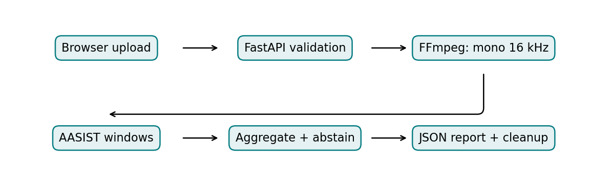
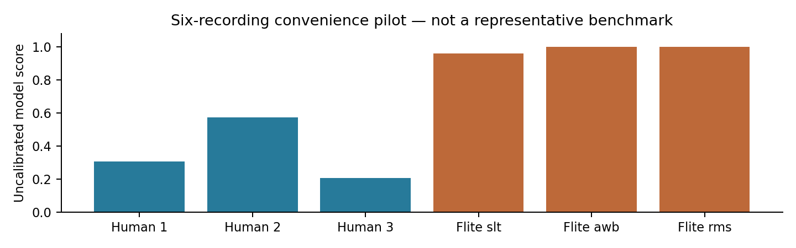
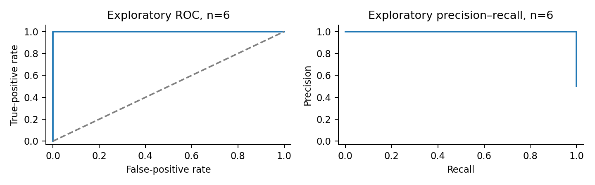
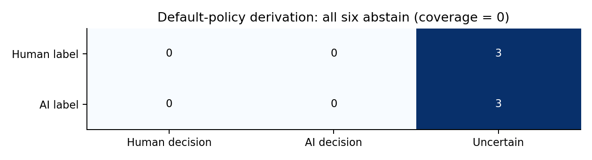

# VoxGuard AI: Deep Learning-Based Analysis of AI-Generated Speech

**Author:** Mohit Mohatkar  
**Institution:** Shri Ramdeobaba College of Engineering and Management  
**Email:** mohitjmohatkar@gmail.com  
**Deep Learning TA2 Report — Draft for academic review**

## 1. Abstract

Synthetic speech and voice cloning create challenges for assessing the authenticity of digital recordings. This project develops VoxGuard AI, a web application that analyzes uploaded speech using the official pretrained AASIST anti-spoofing model. A React interface supports audio uploading, playback, waveform visualization and result inspection. A FastAPI service validates recordings, while FFmpeg converts accepted audio to mono signals sampled at 16 kHz. The PyTorch model processes fixed-length windows, and duration-weighted aggregation produces a recording-level synthetic-oriented score. The score is explicitly treated as uncalibrated, and the application abstains from Human/AI decisions until suitable validation thresholds are established. A recorded exploratory pilot containing three human speech excerpts and three classical Flite text-to-speech recordings achieved AUROC 1.0 and EER 0.0. These results reflect only six convenience-selected recordings and do not establish accuracy on modern synthesis systems. Paired compression and noise experiments reuse the same recordings and therefore do not increase the independent sample count. The project also provides leakage-aware evaluation, optional decision-policy fitting and experimental learned-plus-acoustic feature tooling. Representative multilingual testing and hybrid-model evaluation remain incomplete. Overall, VoxGuard AI demonstrates a functional and reproducible speech-analysis pipeline while making the distinction between model evidence and validated authenticity decisions explicit.

**Keywords:** Speech anti-spoofing; AASIST; audio deepfake detection; graph attention; reproducible evaluation; uncertainty.

## 2. Introduction

Speech synthesis and voice conversion can create convincing spoken content without the corresponding original human performance. This capability has legitimate uses in accessibility, entertainment and language technology, but it also enables impersonation and misleading communication. The distinction between genuine and generated speech is consequently an important research problem. Evaluation must consider the recording domain and the synthesis systems represented in the data, rather than assuming that performance transfers automatically [X. Wang, 2020].

VoxGuard AI investigates this problem through a functioning application built around pretrained AASIST. Integrated spectro-temporal graph attention provides a task-specific anti-spoofing baseline [J. Jung, 2022]. The application accepts recordings, performs controlled preprocessing, computes model scores and exposes their limitations to users. Its primary engineering objective is a real upload-to-inference workflow. Its scientific objective is to support reproducible evaluation of that workflow under independent, properly labeled conditions.

The current scope is audio analysis. The application does not examine video frames, identify the speaker or establish whether spoken statements are true. AI-generated visuals alone do not establish that a video's voice is synthetic. Similarly, a high neural-network score is not proof of manipulation. The report distinguishes operational success from detector reliability throughout.

<!-- PAGE -->
## 2.1 Motivation, objectives and contribution

Raw-waveform approaches make it possible to learn discriminative acoustic patterns without requiring manually selected forensic rules. RawNet2-based anti-spoofing is one established example [H. Tak, 2021], while AASIST integrates spectral and temporal relationships [J. Jung, 2022]. However, deployed users encounter microphones, codecs, languages and generators that may differ from benchmark conditions. A usable application must therefore preserve provenance and communicate uncertainty alongside model outputs.

VoxGuard AI addresses the engineering gap between a pretrained research checkpoint and an accessible, bounded upload application. The implementation uses official weights, validates supported formats, applies consistent preprocessing, displays recording and window scores, and deletes API temporary files. These contributions are software integration and research infrastructure. They are not a newly invented anti-spoofing architecture or an empirically demonstrated state-of-the-art detector.

A second objective is investigating whether learned speech representations and frequency-domain descriptors complement one another. Wav2Vec2 supplies an established representation-learning foundation [A. Baevski, 2020]. WaveFake illustrates the relevance of dataset construction to audio deepfake evaluation [J. Frank, 2021]. The project includes tools for a future frozen-feature fusion comparison, but representative training and independent testing have not been completed. Any improvement remains a hypothesis.

## 3. Literature survey

The ASVspoof 2019 database formalizes synthesis, conversion and replay scenarios and supplies benchmark protocols [X. Wang, 2020]. Its importance is not simply the number of recordings: defined conditions and partitions permit reproducible comparisons. A limitation for the present application is that one benchmark cannot establish behavior on all later generators or real-world recording channels. VoxGuard therefore retains the pretrained model's documented domain and does not infer universal accuracy from successful inference.

RawNet2-based anti-spoofing learns directly from waveform input [H. Tak, 2021]. This reduces dependence on a fixed hand-crafted representation, but does not eliminate domain shift or data requirements. AASIST models spectro-temporal relationships through graph attention [J. Jung, 2022]. VoxGuard adopts AASIST as its initial established baseline, rather than claiming that the application independently reproduces the paper's full benchmark results.

Wav2Vec2 learns speech representations through self-supervised pretraining [A. Baevski, 2020]. Such embeddings may be useful for downstream spoof detection, but an encoder alone is not a validated anti-spoof classifier. WaveFake contributes a dataset for studying generated audio [J. Frank, 2021]; dataset-specific synthesis and source conditions still limit direct transfer claims. Together, these studies motivate careful model provenance, dataset auditing and matched evaluation.

<!-- PAGE -->
## 3.1 Comparison of existing work and research gap

**Table 1. Comparison of directly relevant established studies.**

| Paper | Method or resource | Evaluation focus | Contribution | Limitation for this project |
| --- | --- | --- | --- | --- |
| X. Wang et al., 2020 | ASVspoof 2019 database and protocols | Challenge detection metrics and attack conditions | Structured data for synthesis, conversion and replay research | Does not establish coverage of future generators or Hindi/Marathi |
| H. Tak et al., 2021 | RawNet2 waveform anti-spoofing | Spoof detection under benchmark protocols | End-to-end waveform baseline | Not executed as a matched VoxGuard baseline |
| J. Jung et al., 2022 | AASIST graph-attention detector | Anti-spoofing discrimination | Integrated spectral and temporal modeling | Deployment transfer and calibration require independent evidence |
| A. Baevski et al., 2020 | Wav2Vec2 speech representation learning | Speech representation/downstream tasks | Pretrained learned speech features | Encoder output is not itself an authenticity decision |
| J. Frank and L. Schönherr, 2021 | WaveFake dataset | Audio deepfake evaluation | Supports study of synthetic audio detection | Source/generator scope and license conditions require review |

Table 1 compares methodological roles rather than copying incompatible accuracy values into one ranking. The papers include detectors, an encoder and datasets, so their numerical results would not have a common denominator. The evaluation column identifies the type of evidence required without implying that VoxGuard reproduced each study. The final column describes limitations for the present project, not a claim that each original study failed its own objectives. A matched comparison would require consistent partitions, preprocessing, operating points and hardware.

The main research gap is transfer to recordings outside the pretrained model's original domain. Modern generators, language differences and realistic channels may alter the cues learned during training. The project responds by recording inference provenance and providing evaluation tools, rather than by assuming that a complex architecture solves generalization. The empirical gap remains open until representative recordings are available.

A second gap is communicating model evidence accurately. Users may interpret a displayed score of 0.852 as an 85.2% authenticity probability. VoxGuard explicitly avoids that interpretation. Its default abstention policy prevents unsupported Human/AI labels while retaining the real neural-network score for analysis. This is an application decision policy, not an independent probabilistic calibration method.

**Literature completion status:** five relevant works are discussed. The supplied college format asks for 15–20 reviewed papers, an 8–10-paper comparison table and 25–30 references with recent coverage. Those requirements are not yet fulfilled. Additional scholarly-source access was blocked during preparation; no missing studies, author details, DOI values or performance figures have been invented. This document is a draft until that review is completed.

<!-- PAGE -->
## 4. Methodology and proposed system

The stable system comprises a React frontend, a FastAPI backend, FFmpeg/FFprobe preprocessing and a PyTorch model service. The browser visualizes the selected waveform and submits a multipart request. The API enforces limits and probes the file content before decoding. The model service loads verified official weights and returns scores with provenance. The frontend then renders the structured report.



Figure 1 shows the sequence from user upload to report generation. Each stage has a separate responsibility, which supports testing and replacement without changing unrelated components. Validation precedes inference so unsupported media does not silently enter the neural network. The aggregation stage combines window responses and applies an optional reviewed policy. Temporary API storage is removed after processing, including error paths. The diagram describes the implemented stable pipeline rather than an untrained hybrid model.

## 4.1 Established neural-network technique

AASIST is a speech anti-spoofing network whose architecture combines waveform-based feature extraction with spectro-temporal graph attention [J. Jung, 2022]. The model learns relationships within and across spectral and temporal representations before pooling features for classification. The implementation uses the upstream architecture from NAVER's official repository. It does not retrain the model on user uploads.

The frozen upstream revision is `a04c9863f63d44471dde8a6abcb3b082b07cd1d1`. The expected checkpoint SHA-256 is `51d2d9cf0738172f61e2a384ec50a54a55363240f67c971ed55a92435bc1a1c0`. The downloader verifies this digest, and PyTorch loads the state dictionary strictly with weights-only loading. Missing or corrupted weights produce a setup error. The recorded digest establishes artifact identity relative to the inspected upstream copy; it is not an author signature or evidence of accuracy.

The model's documented training domain is ASVspoof 2019 Logical Access. Its code is distributed under the retained upstream MIT license and notice. Dataset licensing is separate and must be checked for each release used in future research.

<!-- PAGE -->
## 4.2 Data collection and descriptive statistics

The measured pilot contains three licensed LibriSpeech-derived excerpts and three locally generated classical Flite utterances. The human and synthetic classes each contain three recordings, but their sources and generation processes differ strongly. The pilot is therefore a convenience sample suitable for checking the pipeline and exploring scores, not a representative modern deepfake benchmark.

**Table 2. Pilot dataset composition from preserved score records.**

| Property | Human class | Synthetic class |
| --- | --- | --- |
| Source | LibriSpeech-derived excerpts | Local Flite synthesis |
| Independent recordings | 3 | 3 |
| Speaker/voice identifiers | 3 human readers | 3 Flite voice identifiers |
| Language | English | English |
| Duration range | 13.91–16.75 seconds | 4.39–6.02 seconds |
| Total duration | 45.50 seconds | 14.95 seconds |
| Role | Exploratory scoring | Exploratory scoring |
| Training/validation use | None | None |

Table 2 summarizes the six source recordings used in the measured pilot. Durations are calculated from the preserved score CSV and rounded for presentation. Flite voice identifiers are not counted as three additional independently consented human study participants. Balanced class counts do not remove differences in source, duration or synthesis type. All six recordings are evaluation-only convenience observations, so no training/validation/test split ratio is claimed. A future formal experiment must preserve official partitions and audit speaker, source and generator overlap.

Representative acquisitions from sources such as ASVspoof 5 and In-the-Wild remain incomplete because access and metadata verification encountered restrictions. No inaccessible dataset was silently replaced with invented samples. Hindi and Marathi remain study goals and are absent from this measured pilot.

## 4.3 Preprocessing and window preparation

The API supports WAV, MP3, M4A and FLAC, with default limits of 20 MiB and 120 seconds. FFprobe validates containers and streams; FFmpeg converts accepted speech into mono float32 PCM at 16 kHz. Invalid, empty, essentially silent, nonfinite and excessively long signals are rejected. The implementation does not apply generic image resizing, text tokenization, denoising or arbitrary feature normalization merely because they appear as examples in the college template.

AASIST input windows contain 64,600 samples, corresponding to 4.0375 seconds. Short inputs and the final short tail are repeat-padded to match the upstream preparation. Longer recordings use contiguous windows. Duration-weighted aggregation is an application extension whose transfer behavior requires evaluation. Noise and codec transformations are applied only in the offline robustness experiment, not as assumed training augmentation in the stable detector.

<!-- PAGE -->
## 4.4 Score equations, decision policy and implementation

Let z_s and z_h denote the spoof and human output logits for window i. Let d_i denote the original duration represented by that window, excluding repeated padding. Equations (1) and (2) define the window score and aggregate recording score.

EQUATION: s_i = exp(z_s) / [exp(z_s) + exp(z_h)]                         (1)
EQUATION: S = [sum_i(d_i * s_i)] / [sum_i d_i]                          (2)

A larger S is more synthetic-oriented according to the model. It is not a calibrated authenticity probability or the proportion of manipulated audio. With reviewed validation boundaries t_low and t_high, a domain-specific policy can assign Human below the lower boundary, AI above the upper boundary and Uncertain otherwise. No deployment boundaries are enabled in the current system, so every successful default response is Uncertain.

The model runs in evaluation mode using CPU inference and two threads by default. No learning rate, training epoch count or optimizer setting is claimed for the frozen baseline, because it is not trained in this project. Experimental fusion heads have separate configurable training procedures, but no representative hybrid run has produced reportable results. Threshold selection must use validation data and remain frozen during untouched-test evaluation.

```text
receive recording
validate upload size, extension and decoded content
convert to mono 16 kHz float audio
for each consecutive 64,600-sample window:
    repeat-pad the final short window
    run the verified AASIST network
    record spoof-class softmax score and original interval
aggregate scores by original window duration
apply reviewed policy if available; otherwise abstain
return score, segments, metadata and limitations
remove temporary files
```

## 4.5 Interpretation and optional hybrid study

Segment scores help users inspect how responses vary across fixed windows. They are not exact edit localization or a causal explanation of the network. No SHAP, LIME or validated attention-based explanation is implemented, and the browser amplitude waveform is not an explainability method. The report therefore does not fabricate interpretation heatmaps.

The optional research branch extracts frozen Wav2Vec2 representations and LFCC summaries. Learned-only, acoustic-only and fusion heads can be compared using matched recording identities. Training-only normalization and validation-only model selection are required. No hybrid checkpoint is deployed and no benefit over AASIST is claimed. Class imbalance controls must be designed for the actual future training corpus; the six-recording pilot is not used to fit a classifier.

<!-- PAGE -->
## 5. Results and discussion

The recorded development environment used Python 3.12, PyTorch 2.6 CPU and NumPy 1.26.4, with FastAPI, FFmpeg and a React/Vite frontend. A separate mechanical observation was recorded on AMD EPYC 9V45 hardware with two model threads. The user's later Windows demonstration confirms that local upload and inference can operate, but its displayed timings are not substituted for controlled benchmark measurements.

**Table 3. Recorded clean-pilot outcomes and evaluation status.**

| Measure | Recorded value or status |
| --- | --- |
| Independent recordings | 6: three human and three Flite |
| AUROC | 1.0 |
| EER | 0.0 |
| Median model-call latency | Approximately 712.55 ms |
| p95 model-call latency | Approximately 1,119.16 ms |
| Binary accuracy, precision, recall and F1 | Not established: no validated binary threshold |
| Enabled production decisions | All Uncertain by default |

Table 3 reports preserved exploratory measurements, not a new inference run performed for this report. AUROC and EER describe ranking behavior on the six recordings. The latency values exclude decoding and depend on the host, recording duration and applicable first-load work. Binary metrics are intentionally absent because selecting a threshold from the same six test observations would not constitute independent validation. Perfect ranking on this small, source-confounded sample cannot support a 100% reliability claim.



Figure 2 plots the actual preserved recording-level scores. The horizontal axis identifies the three human and three Flite recordings; the vertical axis is the uncalibrated score. The highest human score is approximately 0.574, which also illustrates why an arbitrary 0.5 cutoff cannot simply be assumed correct. The synthetic recordings rank higher in this particular sample. The figure provides a transparent view of the data behind the pilot summary without turning these observations into calibrated probabilities.

<!-- PAGE -->
## 5.1 Evaluation parameters and diagnostic curves

For binary evaluation, AI is the positive class. A true positive is correctly classified AI speech; a false positive is human speech labeled AI. Equations (3)–(6) define commonly required metrics. They are definitions for future frozen-threshold experiments, not measured binary results for the current abstaining application.

EQUATION: Accuracy = (TP + TN) / (TP + TN + FP + FN)                   (3)
EQUATION: Precision = TP / (TP + FP); Recall = TP / (TP + FN)          (4)
EQUATION: F1 = 2 * Precision * Recall / (Precision + Recall)           (5)
EQUATION: FPR = FP / (FP + TN); FNR = FN / (FN + TP)                   (6)

AUROC summarizes ranking discrimination as the threshold varies. EER is a descriptive curve statistic where false-positive and false-negative rates coincide, with interpolation when needed. Neither establishes a deployment threshold chosen independently of the test data. Undefined metric denominators and one-class groups must be reported explicitly.



Figure 3 is regenerated directly from the preserved score CSV without rerunning or changing the model. Both plots contain only three positives and three negatives. Strong visual separation therefore rests on very few observations and a highly restricted synthesis domain. Sweeping thresholds for these curves is descriptive and does not enable a production operating point. No population-level confidence or modern-generator performance claim follows from the plots.



Figure 4 uses the application's documented default abstention rule with the two known pilot classes. All three human and all three synthetic recordings map to Uncertain, giving zero decision coverage. The matrix is an explicit policy derivation, not a new inference experiment or a binary accuracy result. Abstention is not counted as a correct Human/AI classification. Accepted-only accuracy is undefined when no recordings receive a binary decision.

<!-- PAGE -->
## 5.2 Robustness, comparisons and software verification

**Table 4. Paired pilot robustness outcomes.**

| Condition | Source recordings | AUROC | EER |
| --- | --- | --- | --- |
| Clean | Same six | 1.0 | 0.0 |
| MP3 32 kbps | Same six | 1.0 | 0.0 |
| MP3 64 kbps | Same six | 1.0 | 0.0 |
| AAC 64 kbps | Same six | 1.0 | 0.0 |
| White noise, 20 dB SNR | Same six | 1.0 | 0.0 |
| White noise, 10 dB SNR | Same six | 1.0 | 0.0 |

Table 4 preserves the recorded robustness summaries across six conditions. These are 36 paired observations from six recordings, not 36 independent samples. The clean condition is the same source data used for the separate clean report and must not be counted again as independent evidence. The noise conditions use controlled white noise and do not represent all realistic environmental sounds. The results support only the limited observation that ranking separation persisted within this pilot. They do not establish general codec or noise robustness.

**Table 5. Evidence available for candidate comparisons.**

| Candidate | Role | Matched VoxGuard test evidence |
| --- | --- | --- |
| AASIST | Established pretrained anti-spoofing baseline | Six-recording convenience pilot |
| RawNet2 anti-spoofing | Established alternative architecture | Not executed locally |
| Wav2Vec2 | Frozen representation encoder | Feature extraction exercised; not a classifier comparison |
| LFCC-only experimental head | Acoustic comparison | Infrastructure only; representative evaluation pending |
| Learned-plus-LFCC fusion | Proposed comparison | No trained production model or measured improvement |

Table 5 avoids placing literature-reported scores beside the pilot as if the experimental conditions were equivalent. It distinguishes a detector from an encoder and from an untrained experimental head. A fair comparison needs shared recording identities, partitions, operating-point selection and hardware accounting. Head-only speed cannot be compared with full-system inference time. The table consequently records unavailable experiments explicitly instead of filling their results with estimates.

The persisted verification record reports 145 Python tests, 16 frontend tests and a successful frontend build. These are earlier recorded software results, not a fresh execution during report preparation. Real browser checks exercised a human clip and a classical synthetic clip, score rendering, JSON export, invalid uploads and mobile layout. No training/validation loss curves exist for the frozen baseline because this project did not train it. No synthetic loss curves or invented classification report are supplied.

<!-- PAGE -->
## 6. Conclusion and future work

VoxGuard AI implements a functional speech-analysis application using genuine pretrained anti-spoofing inference. The workflow validates uploaded media, converts audio consistently, computes AASIST window scores, aggregates responses and presents the outcome with model provenance. Temporary API recordings are deleted, and the application does not use user uploads for training. Local demonstration is practical without paid inference services.

The scientific result is deliberately limited. Six convenience-selected English recordings exhibit complete ranking separation in the preserved pilot, including the measured paired codec/noise conditions. That outcome is insufficient to establish reliable performance on modern voice cloning or unseen synthesis methods. The project has not obtained representative validation data, enabled defensible deployment thresholds or demonstrated a hybrid-feature improvement. The current default Uncertain classification accurately reflects the absence of those prerequisites.

Future experiments should acquire legitimate corpora with verified licenses and original speaker, source and generator metadata. All derivatives of a source recording must remain linked across splitting decisions. Validation should select thresholds and hyperparameters, while untouched test data supplies final error estimates. Generator-held-out studies should exclude test generator families from both training and validation where the protocol requires it. Unknown exposure during backbone pretraining must remain a disclosed limitation.

Further work includes Hindi and Marathi evaluation using licensed or consented material, realistic background-noise studies, separate analysis of short voice messages and comparisons with modern synthesis families. Learned-only, LFCC-only and fusion heads should be trained on appropriate data using multiple prespecified seeds. Speaker-aware uncertainty and paired robustness comparisons would improve the reliability of conclusions. Probability calibration, if attempted, requires its own validation evidence and must not be inferred from softmax normalization.

Engineering enhancements can include speech-activity screening, process-level hard timeouts, authenticated access, rate limiting and managed hosting with measured memory headroom. The existing cooperative model deadline cannot interrupt a native operation already executing. Public CORS configuration is not authentication. A frontend deployed to Vercel does not itself provide the inference backend, and the current demonstrated configuration runs locally.

## 6.1 Applications and responsible interpretation

The project can support student demonstrations, exploratory audio forensics and reproducible research comparisons. It can help users inspect model responses and understand why evaluation protocols matter. It cannot prove who spoke, identify a specific synthesis tool or guarantee recording authenticity. A high score should not be used as sole evidence for an accusation or identity decision. Reporting calibrated limitations is part of the project's intended contribution, rather than an error to hide from the audience.

<!-- PAGE -->
## 7. References

[J. Jung, 2022] J. Jung, H. Heo, H. Tak, H. Shim, J. S. Chung, B.-J. Lee, H.-J. Yu, and N. Evans, “AASIST: Audio Anti-Spoofing using Integrated Spectro-Temporal Graph Attention Networks,” Proceedings of ICASSP, 2022. Final publisher pagination and DOI should be checked before submission; official architecture and citation provenance are retained in the project.

[H. Tak, 2021] H. Tak, J. Patino, M. Todisco, A. Nautsch, N. Evans, and A. Larcher, “End-to-End anti-spoofing with RawNet2,” Proceedings of ICASSP, pp. 6369–6373, 2021.

[X. Wang, 2020] X. Wang et al., “ASVspoof 2019: A large-scale public database of synthesized, converted and replayed speech,” Computer Speech & Language, vol. 64, article 101114, 2020. DOI: 10.1016/j.csl.2020.101114.

[A. Baevski, 2020] A. Baevski, Y. Zhou, A. Mohamed, and M. Auli, “wav2vec 2.0: A Framework for Self-Supervised Learning of Speech Representations,” Advances in Neural Information Processing Systems, vol. 33, 2020.

[J. Frank, 2021] J. Frank and L. Schönherr, “WaveFake: A Data Set to Facilitate Audio Deepfake Detection,” Proceedings of the Neural Information Processing Systems Datasets and Benchmarks Track, 2021.

## 7.1 Technical provenance and reproducibility

The official AASIST source is https://github.com/clovaai/aasist. Project source is https://github.com/mohitmjm/VoxGuardAI on branch `feature/voxguard-ai`. These repository URLs are technical provenance resources, not additional research papers counted toward the bibliography requirement. The pilot's numerical evidence is preserved in `research/results/pilot_scores.csv`, `pilot_clean.json`, `pilot_robustness.json` and `pilot_provenance.json`. Earlier software verification is recorded in `docs/VERIFICATION.md`.

For local demonstration, start the backend from the repository root with the environment's Python and `-m uvicorn backend.app:app --port 8000`. In a second terminal, run `npm run dev` from `frontend/` and open the printed Vite URL. FFmpeg and FFprobe must be installed, and `python -m ml.download_model` must have obtained the verified checkpoint. A short authorized speech recording is sufficient for an engineering demonstration, but not an accuracy estimate.

## 7.2 Required work before college submission

This draft follows the supplied section structure, single-column A4 layout, 10-point Times New Roman in Word (the PDF embeds its metric-compatible Liberation Serif substitute), equations, figures and tabulated comparisons. The author and institution names were supplied by the student; roll number and guide details were not supplied. The supplied email has been included exactly as provided.

The reference-count and recent-literature requirements remain incomplete: five directly relevant works are included rather than 25–30, and the required 2024–2026 proportion has not been met. The literature survey and comparison-table paper counts are consequently below the template targets. An attempted scholarly metadata lookup was blocked by the environment's network proxy. The final publisher records and new recent studies should be checked against accessible primary publications before submission. No arXiv-only entry is presented as an additional published study to inflate the count.

The requested training curves, validated binary classification report and representative baseline comparisons cannot be produced from the available work. Their absence is stated because the baseline is frozen and a defensible independent threshold study has not occurred. This report is an honest academic draft, not a claim that all template requirements or research-validation objectives have been completed.
