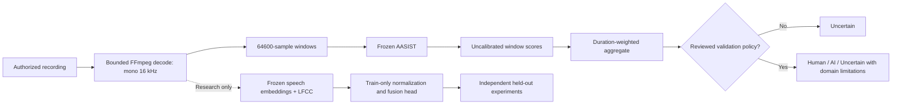

# Robust Detection of AI-Generated Speech Across Unseen Voice Synthesis Models Using Deep Learning and Hybrid Acoustic Representations

**Manuscript status:** reproducible system-and-protocol draft. Not submission-ready as an empirical detection paper: representative held-out experiments are pending. Authors, affiliations, ethics approval (where applicable), venue formatting and author contributions must be supplied by the project team. No novelty or accuracy improvement is claimed.

## 1. Abstract

Synthetic speech detection is vulnerable to shifts in synthesis method, language and recording channel. We implement VoxGuard AI, a privacy-conscious research application that performs genuine pretrained AASIST inference, reports uncalibrated spoof-oriented scores, and abstains by default when deployment thresholds lack representative validation. The system combines bounded audio decoding, contiguous window scoring, documented aggregation, and provenance-aware evaluation. A proposed research extension compares frozen pretrained speech embeddings, linear-frequency cepstral coefficients (LFCCs), and a trainable fusion head. Our protocol separates speakers, original source utterances and synthesis families across partitions; it evaluates discrimination, abstention, error rates and latency under noise and compression. Limited pilot software checks are explicitly distinct from benchmark evidence. **Representative baseline, unseen-generator, multilingual and hybrid-improvement results remain to be collected.** The present contribution is a reproducible implementation and falsifiable experimental protocol, not evidence of universal voice authenticity detection.

## 2. Introduction

Neural text-to-speech and voice cloning reduce the cost of producing plausible imitations of human speech. A detector can assist investigation, but an incorrect accusation has serious consequences and a low model score cannot prove authenticity. This motivates transparent score presentation, conservative abstention and evaluation under domain shift rather than confidence percentages without calibration.

The research question is whether frozen learned speech representations and frequency-domain descriptors, with channel-aware augmentation, improve held-out-generator discrimination relative to a documented anti-spoofing baseline. We also ask how language, noise and compression affect false positives and false negatives. These are hypotheses for controlled experiments. The application does not identify the synthesis platform or infer speaker identity.

## 3. Related Work

AASIST integrates spectro-temporal graph attention for audio anti-spoofing [1]. Its official pretrained checkpoint provides the initial supervised detector. RawNet2 provides a related end-to-end anti-spoofing approach [2]. ASVspoof 2019 supplies standardized bona fide and spoofed speech partitions [3]; dataset protocol compliance is essential when using a checkpoint trained on its logical-access training set.

Wav2vec 2.0 learns speech representations by self-supervision [4]. Such representations are not inherently spoof detectors: a task-specific head and independent evaluation are required. WaveFake provides a public corpus and experimental context for generated-audio detection [5]. We do not transfer published benchmark figures into project result tables, and a model's source-code license does not establish rights to its training recordings.

## 4. Research Gap

Benchmark performance can be confounded by known synthesis systems, speaker overlap, repeated source utterances and codec shortcuts. A model trained in one language or acoustic domain may fail elsewhere. The proposed study therefore examines generator-held-out and source-disjoint testing, paired channel degradation, and language-specific error reporting. We do not assert that these issues are newly discovered; the gap is the absence of project-specific, reproducible evidence for the proposed deployment conditions.

## 5. Problem Formulation

Let recording x have provenance label y ∈ {human, synthetic}; preprocessing P converts x to finite mono 16 kHz samples. Detector f produces spoof-oriented score s ∈ [0,1]. The output is an uncalibrated model score, not P(y=synthetic|x). For two thresholds t_h < t_a chosen only on validation data, predict human if s ≤ t_h, synthetic if s ≥ t_a, and abstain otherwise. Without a reviewed domain-specific policy, all recordings abstain.

AI/synthetic is the positive class. We report binary discrimination (AUROC and interpolated EER) independently of any operating threshold. For abstaining decisions, coverage, per-class abstention and accepted-only accuracy must accompany unconditional error rates; abstentions must not disappear from denominators without explicit labels.

## 6. Proposed Methodology

The established baseline is the official frozen AASIST checkpoint. The proposed comparison extracts frozen speech embeddings and LFCC summary features, normalizes features using training statistics only, and trains a small fusion head. We compare learned-only, acoustic-only and fused inputs with matched splits, seeds and selection rules. Compression-aware augmentation is a controlled factor, not an assumed improvement.

The evaluation pipeline first checks global speaker/source identities and identical audio hashes across partitions. Generator-held-out evaluation excludes test synthesis families from both training and validation. Unknown pretraining overlap is reported rather than silently treated as independent. All derived encodings and crops remain with their original source split. Model and score-protocol digests bind validation policies and test reports.

## 7. Model Architecture

AASIST architecture is vendored from the official NAVER repository at commit `a04c9863f63d44471dde8a6abcb3b082b07cd1d1`, with its MIT license and NOTICE. Checkpoint SHA-256: `51d2d9cf0738172f61e2a384ec50a54a55363240f67c971ed55a92435bc1a1c0`. Loading is strict and uses PyTorch's weights-only mode. Class 0 is spoof, class 1 is bona fide, as documented in the upstream training implementation.

Input windows contain 64,600 mono samples at 16 kHz. Short inputs repeat-pad to this length following upstream evaluation. Longer inputs use contiguous windows; the final short tail repeats, and full-recording scores are duration-weighted window-score means. This long-recording aggregation is an application extension requiring independent validation. Window scores are not exact manipulation localization. No speech-activity detector is applied, so silence, music and non-speech inputs may be misleading.

The optional experimental fusion head is separate from production inference. A pretrained speech encoder supplies learned representations, not anti-spoofing labels. The head uses a 64-unit hidden layer, ReLU, dropout and a binary logit; train-only normalization and validation-only checkpoint selection are implemented. Its outputs have no production validity before test evaluation.

## 8. Dataset Description

The target primary baseline is ASVspoof 2019 LA using official partitions and rights [3]. Additional target datasets include ASVspoof 5, WaveFake [5], and appropriately licensed in-the-wild material after release-specific terms and overlap are reviewed. English benchmark performance is not multilingual evidence. Hindi and Marathi evaluation requires suitable provenance-labeled genuine and synthetic recordings with documented consent, rights, synthesis configuration and disjoint speakers/sources.

A small licensed convenience pilot may establish real speech upload/inference operation; it must not be relabeled a representative benchmark. The pilot result card, if generated, records exact source URLs, licenses, sample count and synthesis type. Classical Flite synthesis is not a modern neural voice-cloning test. No application user's recording is automatically retained or used for training.

| Intended evaluation | Required rights and split evidence | Empirical status |
|---|---|---|
| ASVspoof baseline | Official release terms; train/dev/eval protocol; pretrained overlap | Pending representative run |
| Modern/unseen generators | Authorized outputs; generator-disjoint test; source/speaker audit | Pending |
| Hindi / Marathi | Licensed or consented paired provenance; language metadata | Pending |
| Small software pilot | Per-file license and generation provenance | See `research/results/`; not a benchmark |

## 9. Experimental Setup

All runs record model/checkpoint and manifest hashes, Git revision, dependency versions, machine CPU/RAM, device, thread count, seed and complete commands. Report decoder preprocessing, any truncation, total runtime, and cold-versus-warm latency. The current research decoder limits recordings to 120 seconds; longer source files must be segmented using a documented policy or rejected before a claimed full-recording evaluation.

Fit validation thresholds against an explicit empirical false-positive/false-negative objective with minimum sample and speaker counts. Freeze the resulting artifact before untouched test scoring. Refuse mismatched checkpoints, score protocols and validation/test identity overlap. A fitted operating point is not probability calibration; a probability claim would require a separately assessed calibration method and reliability metrics.

Metrics are accuracy, precision, recall, F1, AUROC, EER, false-positive rate, false-negative rate, confusion matrix and latency. For abstention report coverage, per-class abstention, accepted accuracy and unconditional error denominators. Speaker-cluster bootstrap intervals accompany appropriate multi-speaker evaluations; tiny pilots do not support population-level intervals. Report results separately by dataset, language, generator and channel rather than pooling away failures.

### Acquisition and validation completion audit

A subsequent research-validation pass rechecked authoritative dataset access and supported alternatives. Official GitHub repositories for ASVspoof 5 tools and WaveFake were reachable; reachable tools or MIT-licensed software fixtures did not establish recording licenses, official protocol coverage or generator provenance. Those fixtures were therefore not used as independent research data. Authoritative ASVspoof/Zenodo/Fraunhofer/Hugging Face download or rights endpoints remained blocked by the network proxy. No network-policy bypass was attempted. Dataset-specific resumable acquisition and manual import paths are documented separately in `research/datasets/`; imported recordings must retain original protocol identities and release-specific rights.

No new representative validation or untouched test corpus was acquired in that pass. A new reproducible runner re-exercised the same six prior pilot clips and 36 paired conditions as an engineering regression; its output explicitly records zero validation rows, `policy_status=not_established`, and unavailable decision metrics. This is not a new independent sample or an additional benchmark. Accordingly no new benchmark accuracy, precision, recall, F1, confusion matrix or operating threshold is reported. Existing numerical metric tests and application smoke checks remain software verification; they are not substitutes for independent labeled-data evaluation. The measured convenience pilot below is retained as a narrow earlier observation, rather than relabeled as a completed benchmark. An independent threshold-test report must include model/score-protocol provenance, validation/test source and speaker separation, abstention coverage, errors and sampling uncertainty.

### Exact-source acquisition sprint (2026-10-25)

The requested candidate landing pages were `https://huggingface.co/datasets/mueller91/MLAAD-tiny`, `https://zenodo.org/records/14498691`, and `https://huggingface.co/datasets/mueller91/In-The-Wild`. A bounded access check requested each Hugging Face repository's raw `main/README.md` card and the Zenodo `/api/records/14498691` record. All three failed at the configured proxy tunnel with HTTP 403; no response body was available. Thus **publisher provenance, individual recording/dataset licenses, partition metadata and file availability were not independently verified for these exact candidates**. Their names or user-provided URLs do not establish rights. No new audio was downloaded, no network restriction was bypassed, and the historical six-recording pilot was not rerun in this sprint.

A permitted external acquisition must retain actual release terms, pinned source revision, file inventory/digests and original speaker/source/generator/partition metadata before transfer or import. Selective loading is an engineering convenience, not evidence that a subset is representative. A synthetic-only release cannot by itself supply a valid human/synthetic comparison; any human reference corpus and its source/channel mismatch must be separately documented.

### Statistical and matched-comparison protocol

For a future representative test set, bootstrap units are connected components joining shared speaker and source identifiers, so all related recordings and derived encodings remain together rather than count as independent. The current reporting guard requires at least ten components and one hundred valid resamples per metric from one thousand requested replicates; these engineering minima do not guarantee statistical coverage. Report requested and valid bootstrap replicate counts and undefined intervals when resamples lack both classes. Confidence intervals conditional on a frozen validation-selected threshold do not include threshold-selection uncertainty; the test set must never tune the operating point. The tiny historical pilot still has no reported population interval or binary decision metrics.

The research-only fusion comparison uses frozen Wav2Vec2 features, LFCC summaries and their concatenation, with training-only normalization, validation-loss early stopping and validation-only threshold selection. Freeze test recording identities and audio digests and align AASIST and all head predictions on exactly those recordings. Report per-seed and matched aggregate metrics, head parameter count, checkpoint bytes, head-only timing and feature extraction cost separately. Head-only latency cannot be presented as end-to-end speech inference latency. Numerical fixtures demonstrate pipeline mechanics only. **No real learned-only, acoustic-only or fused head was trained or evaluated in this sprint because suitable identity-audited train/validation/test recordings were unavailable.**

## 10. Results and Discussion

**Representative benchmark results are unavailable. No binary accuracy, robustness gain or modern-generator success is claimed.** Software test counts demonstrate implementation behavior, not detection performance. The measured pilot card (`research/results/pilot_clean.json`) records three licensed LibriSpeech excerpts and three locally generated classical Flite utterances (English, n=6). The real pretrained model ranked these six convenience samples with AUROC 1.0 and descriptive EER 0.0; no binary decision accuracy was computed and no threshold was fitted. The paired robustness run reuses the same six recordings for clean, white noise at 20/10 dB SNR, MP3 at 32/64 kbps, and AAC at 64 kbps (36 observations, not 36 independent recordings). Each condition also had descriptive AUROC 1.0/EER 0.0 in this tiny pilot. This easy classical-synthesis separation is not evidence of modern neural voice-cloning detection, language generalization or population robustness. Raw score artifacts and their digests are retained by the run and summarized in `pilot_robustness.json`. A descriptive EER from a tiny pilot must not be installed as a deployment threshold.

| Experiment | AUROC | EER | FPR / FNR | Coverage | Interpretation |
|---|---|---|---|---|---|
| Official held-out baseline | Not run | Not run | Not run | Not run | Requires licensed benchmark |
| Modern generator / unseen family | Not run | Not run | Not run | Not run | Requires authorized held-out recordings |
| Hindi / Marathi | Not run | Not run | Not run | Not run | No language capability established |
| Hybrid comparison | Not run | Not run | Not run | Not run | No demonstrated improvement |

A separate measured 4.39-second speech run on the cloud CPU (Python 3.12.14, two inference threads) took 573.55 ms cold and 460.26 ms warm, with peak process RSS 495,194,112 bytes including Python/imports; decoding was excluded. These single-recording timings are hardware/run-specific and are not Windows or service-throughput guarantees.

Generate final figures from recorded result JSON via `python -m research.plot_results`, with dataset/conditions in the title. Preserve raw score CSVs and provenance. No fabricated or decorative analytics should replace an unrun experiment.

## 11. Ablation Study

Use the same train/validation/test split and at least three repeatable seeds for learned-only, acoustic-only and fusion heads. Compare augmentation off/on and clean/MP3/AAC/noisy conditions with paired recordings. Select hyperparameters exclusively on validation data. Report parameter count, inference cost, confidence intervals and failure cases alongside discrimination. Test-set threshold tuning and reporting only successful seeds are prohibited. All ablation results remain pending sufficient labeled data and actual training runs.

## 12. Limitations

The deployed baseline is trained on an older English-centric benchmark; Hindi, Marathi, unseen modern synthesis and adversarial edits are unvalidated. The convenience pilot is small and strongly domain-confounded. Scores are uncalibrated; source-code/checkpoint verification establishes provenance, not predictive validity. Segments do not establish edited boundaries. No automatic input-domain verification, speaker authentication or synthesis-platform attribution is provided. Silence, codecs and out-of-domain non-speech may affect scores. Tiny test sets cannot establish a defensible operating point or confidence interval. Windows instructions can be documented and package compatibility checked in Linux, but this does not replace execution on a Windows machine. Public hosting and external peer review are outside the verified local software evidence.

## 13. Conclusion

VoxGuard AI implements a traceable real-model audio analysis workflow and a research protocol that separates software readiness from scientific validity. Its conservative default abstention avoids unsupported authenticity decisions. The next empirical requirements are representative licensed validation/test data, language and generator-held-out evaluation, frozen threshold testing, and controlled hybrid ablations. Claims of detection accuracy or publishable improvement must await those results.

## 14. References

[1] Jee-weon Jung, Hee-Soo Heo, Hemlata Tak, Hye-jin Shim, Joon Son Chung, Bong-Jin Lee, Ha-Jin Yu, and Nicholas Evans. “AASIST: Audio Anti-Spoofing using Integrated Spectro-Temporal Graph Attention Networks.” arXiv:2110.01200, 2021. https://arxiv.org/abs/2110.01200. Author/title/year verified against the [official AASIST citation](https://github.com/clovaai/aasist).

[2] Hemlata Tak, Jose Patino, Massimiliano Todisco, Andreas Nautsch, Nicholas Evans, and Anthony Larcher. “End-to-End anti-spoofing with RawNet2.” Proceedings of ICASSP, pp. 6369–6373, 2021. Citation verified against the official AASIST repository's related-work bibliography.

[3] Xin Wang et al. “ASVspoof 2019: A large-scale public database of synthesized, converted and replayed speech.” Computer Speech & Language, vol. 64, article 101114, 2020. DOI: https://doi.org/10.1016/j.csl.2020.101114. Title/journal/volume/article/year verified against the official AASIST bibliography; et al. avoids an incomplete author list.

[4] Alexei Baevski et al. “wav2vec 2.0: A Framework for Self-Supervised Learning of Speech Representations.” arXiv:2006.11477, 2020. https://arxiv.org/abs/2006.11477. Title, lead-author surname, year and paper identity checked against the authors’ official fairseq implementation; the primary abstract endpoint was blocked in this environment.

[5] Joel Frank and Lea Schönherr. “WaveFake: A Data Set to Facilitate Audio Deepfake Detection.” Thirty-fifth Conference on Neural Information Processing Systems Datasets and Benchmarks Track, 2021. Citation verified against the [official WaveFake repository](https://github.com/RUB-SysSec/WaveFake).

## Source and build notes

IEEE-style LaTeX source and a compiled three-page draft are provided as `manuscript.tex` and `manuscript.pdf`; references are in `references.bib`. `references_verified.md` records which primary/official sources were inspected. The local TeX installation lacks IEEEtran, so the compiled artifact uses the explicitly documented two-column article fallback, not venue-compliant IEEE formatting. Installing IEEEtran activates the conference class automatically. Authorship, institutional details and representative empirical experiments are still pending. See `README.md` in this directory for exact build commands.
